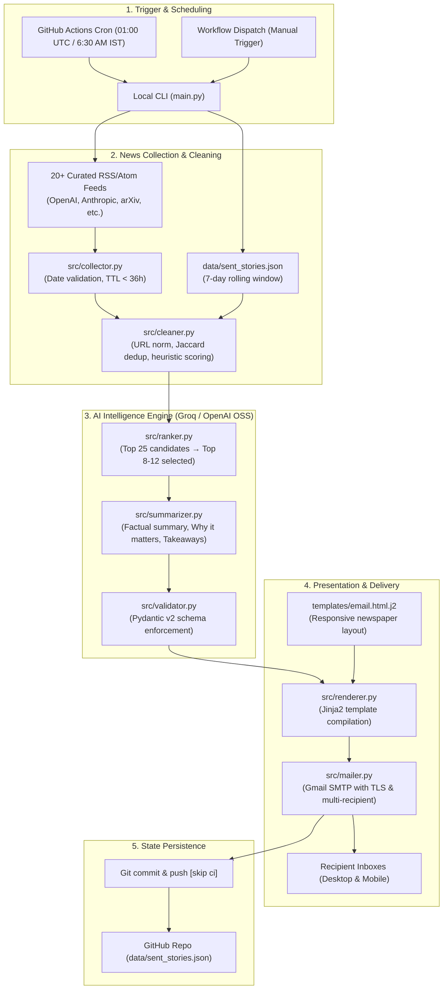
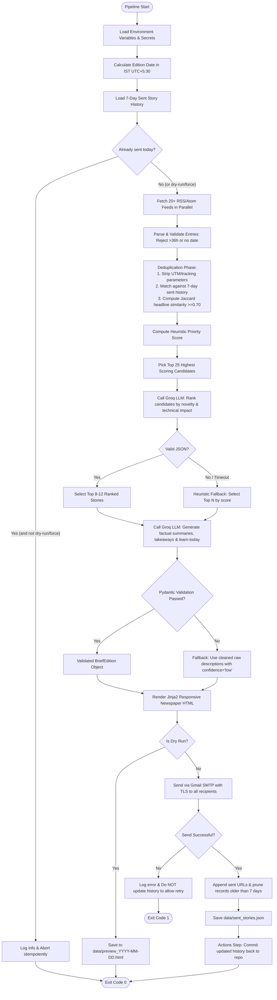

# System Architecture & Technical Workflow — AI Daily Brief 📰

This document provides a complete technical deep-dive into the architecture, workflow, data flow, component interactions, and state persistence of the **AI Daily Brief** automated newspaper pipeline.

---

## 1. High-Level System Architecture

The system is designed as a **serverless, idempotent daily pipeline** that runs via GitHub Actions cron triggers, collects fresh AI developments across primary sources, leverages **OpenAI GPT-OSS on Groq** for zero-cost ranking and structured summarization, renders a responsive HTML email newspaper, delivers it via Gmail SMTP with TLS, and commits deduplication state back to repository storage.



---

## 2. End-to-End Execution Flowchart

The following flowchart outlines the logic and decision pathways during a daily execution run:



---

## 3. Sequence Diagram (Component Interactions)

This diagram details the chronological message passing between components:

```mermaid
sequenceDiagram
    autonumber
    actor GitHub as GitHub Actions Runner
    participant Pipe as pipeline.py
    participant Hist as history.py
    participant Coll as collector.py
    participant Clean as cleaner.py
    participant Groq as Groq API (OpenAI OSS)
    participant Rend as renderer.py
    participant Mail as mailer.py
    actor User as Email Inbox

    GitHub->>Pipe: python main.py
    Pipe->>Hist: load_history()
    Hist-->>Pipe: 7-day sent records
    Pipe->>Pipe: Check if edition already sent today

    Pipe->>Coll: collect_articles(feeds.yaml)
    loop Each RSS Feed
        Coll->>Coll: Fetch XML, parse dates, filter >36h
    end
    Coll-->>Pipe: List of RawArticle objects

    Pipe->>Clean: clean_and_deduplicate(raw_articles, history)
    Clean->>Clean: Normalize URLs (strip UTM/queries)
    Clean->>Clean: Filter out previously sent URLs
    Clean->>Clean: Jaccard similarity (drop duplicate coverage)
    Clean-->>Pipe: Cleaned & sorted candidate list

    Pipe->>Groq: Rank candidates (Top 25 payload)
    Groq-->>Pipe: Ranked index list & scores

    Pipe->>Groq: Summarize top 8-12 articles
    Groq-->>Pipe: JSON summaries, takeaways, learn_today item

    Pipe->>Rend: render_email(BriefEdition)
    Rend-->>Pipe: Rendered responsive HTML string

    Pipe->>Mail: send_email(html, recipients)
    Mail->>User: SMTP TLS Delivery
    User-->>Mail: 250 Message accepted

    Pipe->>Hist: add_sent_stories() & prune_old_records()
    Hist->>Hist: Write data/sent_stories.json
    Pipe-->>GitHub: Process completed (Exit Code 0)
    GitHub->>GitHub: Commit sent_stories.json back to repo
```



---

## 4. Module Responsibilities & Tech Stack

| Module | Primary File | Responsibility | Technologies |
|---|---|---|---|
| **Feed Ingestion** | [`src/collector.py`](src/collector.py) | Parses 20+ feeds, extracts metadata, validates publication timestamps within 36 hours. | `feedparser`, `urllib.parse`, `requests` |
| **Deduplication** | [`src/cleaner.py`](src/cleaner.py) | Strips UTM/hash fragments, computes Jaccard word-overlap similarity ($\ge 0.70$) to drop multi-outlet coverage, scores candidates. | `urllib.parse`, Python sets |
| **Intelligence** | [`src/ranker.py`](src/ranker.py) & [`src/summarizer.py`](src/summarizer.py) | Performs token-optimized two-pass LLM reasoning to rank by technical novelty and generate structured summaries. | `groq`, `openai`, `json` |
| **Data Validation** | [`src/validator.py`](src/validator.py) | Enforces strict type validation, URL checks, category schemas, and rank integrity before rendering. | `pydantic` v2, Python `dataclasses` |
| **Email Templating** | [`src/renderer.py`](src/renderer.py) | Compiles structured story models into sectioned, auto-escaped HTML. | `jinja2`, [`templates/email.html.j2`](templates/email.html.j2) |
| **Delivery Engine** | [`src/mailer.py`](src/mailer.py) | Connects to Gmail SMTP over TLS with authentication, handles comma-separated multi-recipients with retry backoff. | `smtplib`, `email.mime` |
| **History Store** | [`src/history.py`](src/history.py) | Tracks sent story URLs and titles with 7-day retention pruning to prevent repeat stories across days. | `json`, `pathlib` |
| **Pipeline Runner** | [`src/pipeline.py`](src/pipeline.py) & [`main.py`](main.py) | Orchestrates the 8 pipeline stages with `--dry-run`, `--force`, and `--debug` switches. | `argparse`, `logging` |
| **Automation & CI/CD** | [`.github/workflows/daily_brief.yml`](.github/workflows/daily_brief.yml) | Runs serverless daily cron job at 01:00 UTC (6:30 AM IST) and commits updated state back to GitHub. | GitHub Actions, Git CLI |

---

## 5. Deduplication & State Management Details

Because the pipeline runs entirely in **serverless GitHub Actions** without an external database, state is persisted directly within the Git repository:

1. **State File:** [`data/sent_stories.json`](data/sent_stories.json) maintains a list of previously emailed stories:
   ```json
   {
     "url": "https://openai.com/index/gpt-5-announcement",
     "title": "OpenAI announces GPT-5 with improved reasoning",
     "edition_date": "17 October 2026",
     "sent_at": "2026-10-17T01:00:20Z"
   }
   ```
2. **7-Day Rolling Retention:** On every run, records older than 7 days are automatically pruned, keeping the state file compact (< 50 KB).
3. **Double-Send Protection:** If an edition date matches today's date in IST, the pipeline exits early to prevent spamming your inbox if the workflow is re-triggered.
4. **Git Commit-Back:** The GitHub Action automatically runs:
   ```bash
   git commit -m "chore: update sent stories history [skip ci]"
   git push origin main
   ```
   The `[skip ci]` flag ensures this automatic state commit does not trigger an infinite build loop.

---

## 6. Token & Resource Efficiency Architecture

To guarantee the pipeline operates **100% free-of-charge** without hitting rate limits:

1. **Heuristic Pre-Filtering:** The collector and cleaner narrow down 200+ raw RSS entries to the top 25 highest-priority candidates using deterministic priority weights and recency before making any LLM call.
2. **Payload Compression:** Descriptions are truncated to 180–250 characters, and whitespace is minified (`separators=(",", ":")`), keeping input tokens under 1,500 for ranking and under 2,500 for summarization.
3. **Low Total Footprint:** The entire pipeline executes with **fewer than 6,000 tokens per day**, consuming less than 1% of the daily free-tier limit on Groq.
